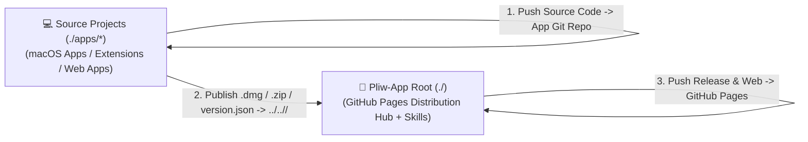

# 🧭 AGENTS.md — Pliw-App Workspace & Release Portal Guide (สำหรับ AI Agents)

> เอกสารฉบับนี้ออกแบบมาเพื่อให้ AI Agents ในทุกเครื่องและทุก Session เข้าใจโครงสร้าง **Pliw-App** (ซึ่งเป็นทั้ง **Workspace Root** ที่เก็บสกิลกลาง/คู่มือ และ **Public GitHub Pages Release Portal** ที่ `https://pakkawatkh.github.io/Pliw-App/`) รวมถึงทำ **End-to-End Dev -> Test -> Package -> Release & Deploy** ได้เองอัตโนมัติโดยไม่ต้องรอให้ผู้ใช้สั่งซ้ำ

---

## 🚨 กฎเหล็กสูงสุด (Mandatory Rules — ต้องทำทุกครั้งโดยไม่ต้องรอให้สั่งซ้ำ!)

### 1. เมื่อ Dev / แก้โค้ดเสร็จ ต้องทำ Build → Update หน้าเว็บ → Push ให้ครบในรวดเดียว!
ทุกครั้งที่พัฒนาหรือแก้ไขแอปใดๆ ใน `./apps/` เสร็จสิ้น **ห้ามหยุดแค่แก้โค้ดเสร็จ** แต่ต้องทำขั้นตอนต่อไปนี้ให้ครบจบเสมอ (ดูรายละเอียดเพิ่มเติมใน `./RELEASE_WORKFLOW.md` และ `AGENTS.md` ในแต่ละ Repo):

- **🅰️ กรณีแอป macOS Native (`./apps/monkey-tools`, `./apps/Pliw-Click`, `./apps/Pliw-Collage`):**
  1. **Test:** รัน `swift test` ให้ผ่าน 100% (0 failures)
  2. **Bump Version:** อัปเดตเลขเวอร์ชันใหม่ใน `scripts/build_app.sh` (`CFBundleShortVersionString` & `CFBundleVersion`)
  3. **Build & Package:** รัน `./scripts/create_dmg.sh` เพื่อ Build Release `.app`, Sign ด้วย Certificate ถาวร, ติดตั้งลง `/Applications/`, สร้าง `.dmg` + `.zip` และซิงก์เข้า `../../<app-slug>/` (หรือ `./<app-slug>/` จาก Root ของ `Pliw-App`) อัตโนมัติ
  4. **Check Exact File Size:** รัน `ls -lh ../../<app-slug>/*.dmg ../../<app-slug>/*.zip` เพื่อเอาขนาดไฟล์จริงไปอัปเดตหน้าเว็บ
  5. **Update หน้าเว็บ & Auto-Updater (`Pliw-App` Root = `../../`):**
     - อัปเดต `<app-slug>/version.json` (`latestVersion`, `releaseNotes`, `publishedAt`/`releaseDate`) โดย URL ต้องใช้ `https://pakkawatkh.github.io/Pliw-App/...` (ตัวพิมพ์ใหญ่ `Pliw-App`)
     - อัปเดตเลขเวอร์ชันและขนาดไฟล์จริงใน `index.html`, `<app-slug>/index.html`, `README.md` ของ `Pliw-App` และ `README.md` ของตัวแอป
  6. **Push ทั้ง 2 Repo:** ตรวจ `git status` ให้แน่ใจว่าไม่มีไฟล์ `.app`/`.dmg`/`.zip` หลุดเข้า Repo โค้ด จากนั้น `git add -A && git commit && git push origin main` **ทั้งใน Repo ของตัวแอป (`./apps/<repo>`) และใน `Pliw-App` Root (`./`)** (และเปิดแอปใหม่ด้วย `open "/Applications/<App Name>.app"` สำหรับแอป Menu Bar)

- **🅱️ กรณีส่วนขยายเบราว์เซอร์ (`./apps/pliw-extension`: `pliw-scroll`, `pliw-geo`):**
  1. **Bump Version:** อัปเดตเลข `"version"` ใน `<ext-name>/manifest.json`
  2. **Package ZIP:** รัน `zip -r ../../<ext-name>/<ext-name>-vX.Y.Z.zip <ext-name> -x "*.DS_Store" "*__MACOSX*"` (และลบไฟล์ `.zip` เวอร์ชันเก่าใน `../../<ext-name>/` ออก)
  3. **Check Size & Update หน้าเว็บ:** เช็กขนาดไฟล์จริงด้วย `ls -lh` แล้วอัปเดตเวอร์ชัน ลิงก์ และขนาดไฟล์ใน `../../index.html`, `../../<ext-name>/index.html`, `../../README.md` และ `./README.md`
  4. **Push ทั้ง 2 Repo:** `git add -A && git commit && git push origin main` **ทั้งใน `./apps/pliw-extension` และ `Pliw-App` Root**

- **🅲 กรณีเว็บแอปพลิเคชัน (Web App ที่มี `package.json` / Vite / React):**
  1. รัน `npm run build` เพื่อตรวจสอบ TypeScript (`tsc -b`) และสร้างไฟล์ Production ใน `dist/`
  2. ซิงก์ไฟล์ Build หรืออัปเดตหน้าเว็บใน Release Portal พร้อม Commit & Push ขึ้น GitHub ให้เรียบร้อย

- **✨ กรณีสร้างแอปใหม่เพิ่มเข้ามาในอนาคต (`./apps/<new-app>`):**
  1. สร้าง Git repo แยก (Public · MIT License) ไว้ใน `./apps/<new-app>` พร้อม `AGENTS.md` ภาษาอังกฤษใน Root ของ Repo (โฟลเดอร์ `apps/` ถูก `.gitignore` โดย `Pliw-App` อัตโนมัติ)
  2. สร้างสคริปต์ Build/Package ที่ส่งไฟล์ติดตั้ง (`.dmg` / `.zip` / `dist/`) ไปยัง `../../<new-app>/` (พร้อม fallback `../Pliw-App/<new-app>/`)
  3. สร้างหน้า `./<new-app>/index.html` ตาม Template กลาง, ไฟล์ `version.json`, เพิ่มการ์ดแอปในหมวด `Apps` หรือ `Extensions` ใน `./index.html` และอัปเดต `./sitemap.xml`
  4. อัปเดตข้อมูลแอปใหม่ลงใน `AGENTS.md` ทันที

### 2. ข้อห้ามและข้อควรระวังสำคัญ
- **รองรับ 2 ภาษา (`th`, `en`) เป็นมาตรฐานทุกแอป:** ทุกแอปที่สร้างหรือพัฒนาใหม่ใน Workspace นี้ **ต้องรองรับ 2 ภาษา คือ ภาษาไทย (`th`) และภาษาอังกฤษ (`en`)** พร้อมปุ่มสลับภาษาใน Settings/UI และบันทึกค่าไว้ในระบบตั้งค่าของแอป
- **Nested Multi-Repo Layout (`apps/` is gitignored):** `Pliw-App/` เป็น Git repo หลักสำหรับหน้าเว็บ + สกิลกลาง (`.agents/`, `.superpowers/`, `docs/`, `AGENTS.md`, `RELEASE_WORKFLOW.md`) ส่วนโค้ดเบสของแต่ละแอปอยู่ใน `./apps/<repo>/` ซึ่งเป็น Git repo แยกของตัวเองและถูก ignore ไว้ใน `.gitignore` ของ `Pliw-App` เสมอ เวลาสั่ง `git` ของแอปใดให้ `cd` เข้าไปยัง `./apps/<repo>/` ก่อนเสมอ (ห้ามใช้ Absolute Path ตายตัวในสคริปต์)
- **ห้ามกรองรหัสผ่านใน Clipboard:** ในแอปจัดการคลิปบอร์ด (`monkey-tools`) **ห้าม** กรองหรือข้ามข้อมูลที่เป็นรหัสผ่าน (`ConcealedType` / `TransientType`) เพราะผู้ใช้ต้องการให้บันทึกรหัสผ่านด้วย
- **รักษาสิทธิ์ TCC Accessibility บน macOS:** `scripts/build_app.sh` ใช้ใบรับรอง Self-signed ถาวร (`MonkeyToolsDeveloper` / `MonkeyCopyDeveloper`) ในการ Sign แอปเพื่อไม่ให้สิทธิ์ Accessibility หลุดหลัง Build ใหม่ ห้ามลบกลไกการ Sign นี้ออก
- **ตรวจสอบ Skills ก่อนลงมือทำ:** ตรวจสอบทักษะใน `./.agents/skills/` และเอกสารแผนงานเดิมใน `./docs/superpowers/` ก่อนเริ่มงานซับซ้อนเสมอ

### 3. กติกามาตรฐานหน้าเว็บ Pliw-App (`index.html` & `<app-slug>/index.html`)
- **100% English Website:** Zero Thai text anywhere in `*.html` or `README.md`.
- **Human, Direct Product Copy (No AI Slop):**
  - ห้ามใช้คำฟุ่มเฟือยสไตล์ AI (*Thoughtfully Handcrafted*, *curated suite*, *elevate your workflow*, *Apple-Grade Craftsmanship*, *Liquid Glass*, *Fluid Glassmorphism*, *zero bloatware*)
  - ห้ามใส่คีย์ลัด (`⌘⇧V`, `⌘V`, `⌘1–9`) ลงในคำอธิบายประโยชน์ของแอป และห้ามใส่ป้าย `MIT License` ซ้ำในส่วน Hero (ให้แสดงเฉพาะใน Footer)
- **Homepage (`index.html`) Standards:**
  - **Navbar:** Minimal MacBook-style brand icon (`assets/favicon.svg`) + `Pliw App` + มีเฉพาะ `Apps` กับ `Extensions` และปุ่ม `GitHub` (ห้ามเอาชื่อแอปรายตัวมาใส่บน Navbar)
  - **Categories:** แบ่งหมวดหมู่ **Apps** และ **Extensions** ชัดเจนพร้อมแท็บกรอง (`All`, `Apps`, `Extensions`)
  - **App Cards:** จัดชิดบน (`align-items: start` กับ `padding-top: 58px`) ให้ระยะห่างป้ายเวอร์ชันเท่ากันทุกใบ แสดงเฉพาะ Icon + App Name + Platform, ประโยชน์หลัก 1 บรรทัด, 2 ปุ่ม (`Details →`, `Download DMG/ZIP (size)`) และพรีวิวด้านขวา ไม่มี feature tag grids หรือวิดีโอโปรโมทเก่า
- **Unified App Detail Page Template (`<app-slug>/index.html`):**
  - ใช้ Stylesheet กลาง `../assets/app-page.css` และโครงสร้างมินิมอลเดียวกันทุกหน้า: **Navbar → Hero → Preview → Quick Install → Footer**
  - **Hero:** ไอคอน + ชื่อแอป (`<h1>App Name</h1>`) → ประโยชน์หลัก 1 บรรทัด → ปุ่มดาวน์โหลด (พร้อมเวอร์ชันและขนาดจริง) + ปุ่ม `GitHub` → ป้ายการรองรับ 1 อัน (`macOS 13.0+ (Apple Silicon & Intel)` หรือ `Chrome · Brave · Edge (Manifest V3)`)
  - **Cross-page consistency:** หากปรับปรุง `assets/app-page.css` หรือโครงสร้าง Template กลาง ให้พิจารณาปรับหน้าอื่นตามความเหมาะสม

### 4. กติกามาตรฐานระบบอัปเดตในแอป (Mandatory One-Click In-App Auto-Updater)
- **แอป macOS Native ทุกตัวต้องมี Auto-Updater แบบ 1 คลิก** (เหมือน `monkey-tools`, `Pliw-Click`, `Pliw-Collage`):
  1. เช็กเวอร์ชันล่าสุดจาก `https://pakkawatkh.github.io/Pliw-App/<app-slug>/version.json` อัตโนมัติตอนเปิดแอป และมีปุ่ม **Check for Updates** ให้กดเช็กเองได้
  2. เมื่อมีเวอร์ชันใหม่ แสดงแจ้งเตือนพร้อมปุ่ม **Update Now** แบบ 1 คลิก ที่จะดาวน์โหลด `.zip` → แตกไฟล์ → ลบ Quarantine (`xattr -cr`) → แทนที่ `.app` ใน `/Applications/` → เปิดแอปใหม่ให้อัตโนมัติทันทีโดยผู้ใช้ไม่ต้องโหลด DMG เอง
  3. รักษา `CFBundleIdentifier` และ Certificate การ Sign เดิมเสมอ เพื่อให้การอัปเดตไม่ทำให้สิทธิ์ macOS (เช่น Accessibility) หลุด

---

## 1. ภาพรวมโครงสร้าง Workspace (`Pliw-App` Root)

ใช้ Relative Path อ้างอิงจาก Root ของ `Pliw-App` เสมอ เพื่อรองรับการพัฒนาในทุกเครื่อง:

```text
Pliw-App/                        # [Git Repo] Workspace Root + GitHub Pages Release Portal
├── .gitignore                   # Ignore โฟลเดอร์ apps/ และไฟล์ชั่วคราว
├── AGENTS.md                    # กฎเหล็กและคู่มือสถาปัตยกรรมสำหรับ AI (ไฟล์นี้)
├── RELEASE_WORKFLOW.md          # คู่มือขั้นตอนการ Build, Package และ Deploy ทุกประเภทแอป
├── .agents/ & .superpowers/     # Central AI Skills & SDD configs
├── skills-lock.json             # Skill lockfile
├── docs/                        # Specs & Implementation Plans
├── index.html & assets/         # หน้าเว็บหลัก Pliw App (https://pakkawatkh.github.io/Pliw-App/)
├── monkey-tools/                # Published page, version.json, .dmg, .zip
├── pliw-click/                  # Published page, version.json, .dmg, .zip
├── pliw-collage/                # Published page, version.json, .dmg, .zip
├── pliw-scroll/                 # Published page, .zip
├── pliw-geo/                    # Published page, .zip
└── apps/                        # [Gitignored by Pliw-App] โฟลเดอร์เก็บโค้ดเบสและ Repo ของแต่ละแอป
    ├── monkey-tools/            # [Git Repo] Swift / SwiftUI / AppKit
    ├── Pliw-Click/              # [Git Repo] Swift / SwiftUI / AppKit
    ├── Pliw-Collage/            # [Git Repo] Swift / SwiftUI / AVFoundation
    ├── pliw-extension/          # [Git Repo] Chromium Manifest V3 (pliw-scroll, pliw-geo)
    ├── business-card-studio/    # [Web App] React + TS + Vite
    └── epic-fan/                # [Web Prototype]
```



---

## 2. รายละเอียดโปรเจกต์ย่อยในปัจจุบัน (Current Sub-Projects)

### 2.1 🚀 `Pliw-App` (Workspace Root & Public Release Portal)
- **Relative Path:** `./`
- **Git Remote:** `https://github.com/pakkawatkh/Pliw-App.git`
- **Live URL:** `https://pakkawatkh.github.io/Pliw-App/` *(case-sensitive path — always use `Pliw-App`, never lowercase `pliw-app`)*
- **หน้าที่หลัก:** โฟลเดอร์หลักของ Workspace (เก็บสกิลกลาง/คู่มือ) และศูนย์กลางเผยแพร่แอปพลิเคชันและส่วนขยายทั้งหมดผ่าน GitHub Pages (`index.html`, `<app-slug>/`, `.dmg`, `.zip`, `version.json`)

### 2.2 🐵 `monkey-tools` (macOS Productivity Menu Bar Suite)
- **Relative Path:** `./apps/monkey-tools`
- **Git Remote:** `https://github.com/pakkawatkh/monkey-tools.git`
- **Portal Folder:** `./monkey-tools/` (`https://pakkawatkh.github.io/Pliw-App/monkey-tools/`)
- **Tech Stack:** Swift 5.9+, SwiftUI, AppKit, Vision (Offline OCR), Carbon (`RegisterEventHotKey`), CoreGraphics (`CGEvent`), macOS 13.0+
- **ฟีเจอร์หลัก:** Clipboard History, Continuous Emoji Picker, Smart Selection Translator & Quick Translate, In-App Auto-Updater & 3 Languages (`th`, `en`, `zh`)
- **คำสั่งสำคัญ:**
  ```bash
  cd ./apps/monkey-tools
  swift test                  # รัน Unit Tests ทั้งหมด
  ./scripts/build_app.sh      # Build .app, Sign ใบรับรอง และติดตั้งลง /Applications
  ./scripts/create_dmg.sh     # สร้าง .dmg + .zip และซิงก์เข้า ../../monkey-tools/
  ```

### 2.3 📸 `pliw-extension` (Chromium Browser Extensions: `pliw-scroll`, `pliw-geo`)
- **Relative Path:** `./apps/pliw-extension`
- **Git Remote:** `https://github.com/pakkawatkh/pliw-extension.git`
- **Portal Folders:** `./pliw-scroll/` และ `./pliw-geo/`
- **Tech Stack:** Vanilla JS (ES6+), OffscreenCanvas, IndexedDB, Chrome Extension Manifest V3

### 2.4 🪪 `business-card-studio` (Visual Business Card Design Studio)
- **Relative Path:** `./apps/business-card-studio`
- **Tech Stack:** React 18, TypeScript, Vite 6, Tailwind CSS 3

### 2.5 🧩 `Pliw Collage` (`Pliw-Collage` — macOS Video Collage Studio)
- **Relative Path:** `./apps/Pliw-Collage`
- **Git Remote:** `https://github.com/pakkawatkh/Pliw-Collage.git`
- **Portal Folder:** `./pliw-collage/` (`https://pakkawatkh.github.io/Pliw-App/pliw-collage/`)
- **Tech Stack:** Swift 5.9+, SwiftUI, AppKit, AVFoundation, CoreImage, macOS 13.0+
- **คำสั่งสำคัญ:**
  ```bash
  cd ./apps/Pliw-Collage
  swift test
  ./scripts/build_app.sh
  ./scripts/create_dmg.sh     # สร้าง .dmg + .zip และซิงก์เข้า ../../pliw-collage/
  ```

### 2.6 🖱️ `Pliw Click` (`Pliw-Click` — macOS Universal Middle-Click & Autoscroll)
- **Relative Path:** `./apps/Pliw-Click`
- **Git Remote:** `https://github.com/pakkawatkh/Pliw-Click.git`
- **Portal Folder:** `./pliw-click/` (`https://pakkawatkh.github.io/Pliw-App/pliw-click/`)
- **Tech Stack:** Swift 5.9+, SwiftUI, AppKit, CoreGraphics (`CGEventTap`), IOKit, `MultitouchSupport.framework`, macOS 13.0+
- **คำสั่งสำคัญ:**
  ```bash
  cd ./apps/Pliw-Click
  swift test
  ./scripts/build_app.sh
  ./scripts/create_dmg.sh     # สร้าง .dmg + .zip และซิงก์เข้า ../../pliw-click/
  ```
