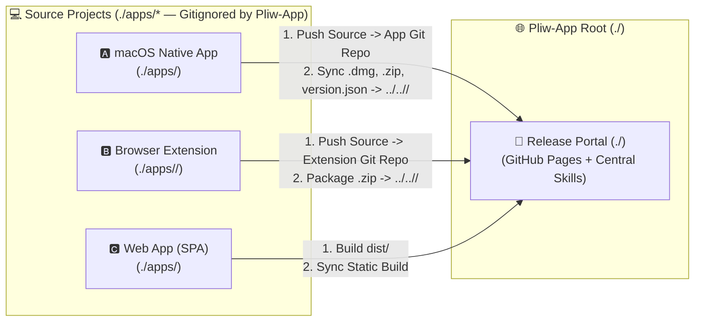

# 🚀 คู่มือมาตรฐานการพัฒนา แพ็กเกจ และ Deploy ทุกแอป (Master Dev & Release Workflow)

เอกสารฉบับนี้เป็น **Standard Operating Procedure (SOP)** สำหรับทุกโปรเจกต์ใน Workspace รวมถึงเป็นแม่แบบ (Playbook) สำหรับแอปพลิเคชัน ส่วนขยาย หรือเว็บแอปตัวใหม่ที่จะเพิ่มเข้ามาในอนาคต โดยอ้างอิงผ่าน **Relative Path (`./` และ `../`)** เพื่อให้สามารถพัฒนาและ Deploy ได้จากทุกเครื่องโดยไม่ยึดติดกับ Path หรือชื่อโฟลเดอร์ตายตัว

---

## 🏗️ 1. ภาพรวมโครงสร้างและจุดหมายการ Deploy (Ecosystem & Deployment Map)

โปรเจกต์ใน Workspace ใช้ **`Pliw-App/` เป็นโฟลเดอร์หลัก** (เก็บทั้งหน้าเว็บ GitHub Pages + สกิลกลาง) และเก็บ **Source Projects (แต่ละแอปมี Git Repo ของตัวเอง)** ไว้ภายใต้โฟลเดอร์ `./apps/` (ซึ่งถูก `.gitignore` โดย `Pliw-App`):



| ประเภทโปรเจกต์ | Source Repo (เก็บซอร์สโค้ด) | จุดหมายการ Deploy (Release Portal) |
| :--- | :--- | :--- |
| **🅰️ macOS Native App** | `./apps/<app-name>` (Git Repo ของแอป) | `../../<app-slug>/` หรือ `./<app-slug>/` (`.dmg`, `.zip`, `version.json`, `index.html`) |
| **🅱️ Browser Extension** | `./apps/<ext-repo>/<ext-name>` (Git Repo ของส่วนขยาย) | `../../<ext-name>/` หรือ `./<ext-name>/` (`.zip`, `index.html`) |
| **🅲 Web App (SPA)** | `./apps/<web-app>` (Git Repo ของเว็บแอป) | Build `dist/` ไปวางที่ `../../<web-app>/` หรือโฮสติ้งปลายทาง |
| **🚀 Release Portal** | `./` (`Pliw-App` Root) | **GitHub Pages:** `https://pakkawatkh.github.io/Pliw-App/` |

---

## 📦 2. ขั้นตอนการทำงานแยกตามประเภทแอป (Step-by-Step per App Type)

---

### 🅰️ ประเภทที่ 1: แอป macOS Native (Swift / SwiftUI / AppKit)

#### Step 1: Dev & Test
```bash
cd ./<app-name>

# 1. รัน Unit Tests ทั้งหมดให้ผ่าน
swift test

# 2. ทดลอง Build และติดตั้งลง /Applications เพื่อเทสต์จริง
./scripts/build_app.sh
open "/Applications/<app-name>.app"
```

#### Step 2: Bump Version & Package (`.dmg` + `.zip`)
1. แก้เลขเวอร์ชันใน `./<app-name>/scripts/build_app.sh` (`CFBundleShortVersionString` และ `CFBundleVersion` เช่น `X.Y.Z`)
2. รันสคริปต์สร้างแพ็กเกจ:
   ```bash
   ./scripts/create_dmg.sh
   ```
   *(สคริปต์จะ Build Release, Sign ใบรับรอง, สร้าง `.dmg` + `.zip` และ Copy ไปยัง `./docs/` และ `../pliw-app/<app-name>/` อัตโนมัติ)*

#### Step 3: อัปเดต Auto-Updater & หน้าเว็บใน Release Portal
1. แก้ไฟล์ `../pliw-app/<app-name>/version.json`:
   ```json
   {
     "latestVersion": "X.Y.Z",
     "downloadUrl": "https://pakkawatkh.github.io/Pliw-App/<app-name>/<app-name>-Installer.dmg",
     "zipUrl": "https://pakkawatkh.github.io/Pliw-App/<app-name>/<app-name>.zip",
     "releaseNotes": "- สรุปฟีเจอร์ใหม่และการแก้ไขบั๊ก",
     "publishedAt": "YYYY-MM-DDTHH:MM:SSZ"
   }
   ```
2. แก้เลขเวอร์ชันบนหน้าเว็บ:
   - `../pliw-app/index.html` (การ์ดของแอปและป้าย Badge)
   - `../pliw-app/<app-name>/index.html` (Badge บน Hero, ปุ่ม Download, ตารางเปรียบเทียบ)

#### Step 4: Commit & Deploy (ทั้ง 2 Git Repos)
```bash
# 1. Push ซอร์สโค้ดขึ้น Git Repo ของตัวแอป
cd ./<app-name>
git add .
git commit -m "feat: release vX.Y.Z - <สรุปการเปลี่ยนแปลง>"
git push origin main

# 2. Push ไฟล์ติดตั้ง + version.json + หน้าเว็บขึ้น Release Portal
cd ../pliw-app
git add <app-name>/ index.html
git commit -m "chore(release): update <app-name> to vX.Y.Z"
git push origin main
```

---

### 🅱️ ประเภทที่ 2: ส่วนขยายเบราว์เซอร์ (Chromium Manifest V3 Extension)

#### Step 1: Dev & Test
1. แก้ไขโค้ดใน `./<ext-repo>/<ext-name>/`
2. เปิดเบราว์เซอร์ไปที่ `chrome://extensions/` -> เปิด **Developer mode**
3. กด **Load unpacked** เลือกโฟลเดอร์ `./<ext-repo>/<ext-name>` (หรือกดปุ่ม Reload `🔄`) เพื่อทดสอบ

#### Step 2: Bump Version & Package (`.zip`)
1. อัปเดตเลข `"version"` ในไฟล์ `./<ext-repo>/<ext-name>/manifest.json` (เช่น `"X.Y.Z"`)
2. บีบอัดโฟลเดอร์ส่วนขยายเป็นไฟล์ `.zip` ไปวางที่ Release Portal:
   ```bash
   cd ./<ext-repo>
   zip -r ../pliw-app/<ext-name>/<ext-name>-vX.Y.Z.zip <ext-name> -x "*.DS_Store*"
   ```

#### Step 3: อัปเดตหน้าเว็บใน Release Portal
1. อัปเดตลิงก์ดาวน์โหลด `.zip` และเลขเวอร์ชันใน:
   - `../pliw-app/<ext-name>/index.html`
   - `../pliw-app/index.html`

#### Step 4: Commit & Deploy (ทั้ง 2 Git Repos)
```bash
# 1. Push ซอร์สโค้ดขึ้น Git Repo ของส่วนขยาย
cd ./<ext-repo>
git add .
git commit -m "feat(<ext-name>): release vX.Y.Z - <สรุปการเปลี่ยนแปลง>"
git push origin main

# 2. Push ไฟล์ .zip และหน้าเว็บขึ้น Release Portal
cd ../pliw-app
git add <ext-name>/ index.html
git commit -m "chore(release): update <ext-name> to vX.Y.Z"
git push origin main
```

---

### 🅲 ประเภทที่ 3: เว็บแอปพลิเคชัน (React / TypeScript / Vite)

#### Step 1: Dev & Test
```bash
cd ./<web-app>
npm run dev
```

#### Step 2: Verify TypeScript & Production Build
```bash
cd ./<web-app>

# ตรวจสอบ Type Error (tsc -b) และสร้างไฟล์ Production ลงโฟลเดอร์ dist/
npm run build
```
> **💡 สำคัญ:** หากต้องการโฮสต์เว็บแอปไว้ภายใต้ Subfolder ของ Release Portal (`https://pakkawatkh.github.io/Pliw-App/<web-app>/`) ให้ตั้งค่า `base: '/pliw-app/<web-app>/'` ใน `vite.config.ts` ก่อนรัน `npm run build`

#### Step 3: Deploy ขึ้น Release Portal
```bash
mkdir -p ../pliw-app/<web-app>
cp -R ./dist/* ../pliw-app/<web-app>/

cd ../pliw-app
git add <web-app>/ index.html
git commit -m "feat: deploy <web-app> update"
git push origin main
```

---

## ✨ 3. Playbook: เมื่อสร้างแอปใหม่ในอนาคต ต้องทำอะไรบ้าง? (New App Onboarding)

เมื่อสร้างแอปใหม่ `./<new-app>` ใน Workspace ให้ทำตามมาตรฐาน 4 ข้อนี้:

1. **แยก Git Repository เฉพาะของแอปนั้น:**
   ```bash
   mkdir ./<new-app> && cd ./<new-app> && git init
   ```
2. **สร้างสคริปต์ Build & Sync โดยใช้ Relative Path (`../pliw-app/<new-app>/`):**
   - ห้ามเขียน Absolute Path ของเครื่องลงในสคริปต์ (ให้ใช้ `SCRIPT_DIR="$(cd "$(dirname "$0")" && pwd)"` แล้วอ้างอิงผ่าน Relative Path เสมอ)
3. **ลงทะเบียนแอปใหม่ใน Release Portal (`../pliw-app`):**
   - สร้างโฟลเดอร์ `../pliw-app/<new-app>/` พร้อม `index.html` และ `version.json` (ถ้ามี Auto-Update)
   - เพิ่มการ์ดโปรโมตแอปใน `../pliw-app/index.html` และเพิ่มลิงก์ใน `../pliw-app/sitemap.xml`
4. **อัปเดต `AGENTS.md`:**
   - เพิ่มข้อมูลโปรเจกต์ใหม่ลงใน `./AGENTS.md` เพื่อให้ AI Agent รู้จักโครงสร้างและคำสั่งของแอปใหม่ทันทีในทุกเครื่องและทุก Session

---

## ⚡ 4. Quick Release Checklist (เช็กก่อนจบงานทุกครั้ง)

- [ ] **1. Test ผ่าน:** รัน `swift test` (macOS) / `npm run build` (Web) / ทดสอบ Load unpacked (Extension)
- [ ] **2. Bump Version:** อัปเดตเลขเวอร์ชันในโค้ด (`build_app.sh` / `manifest.json` / `package.json`)
- [ ] **3. Build Package:** สร้างไฟล์สำหรับแจกจ่าย (`.dmg`, `.zip`, หรือ `dist/`)
- [ ] **4. Sync เข้า Release Portal (`../pliw-app`):**
  - วางไฟล์แพ็กเกจใหม่ใน `../pliw-app/<app-name>/`
  - อัปเดต `../pliw-app/<app-name>/version.json` *(ถ้ามีระบบ Auto-Update)*
  - อัปเดตเลขเวอร์ชันใน `../pliw-app/index.html` และ `../pliw-app/<app-name>/index.html`
- [ ] **5. Git Push ครบทั้ง 2 ฝั่ง:**
  - Push ซอร์สโค้ดขึ้น Git Repo ของแอปนั้นๆ
  - Push ไฟล์ Release และหน้าเว็บขึ้น Git Repo ของ Release Portal (`pliw-app`)
