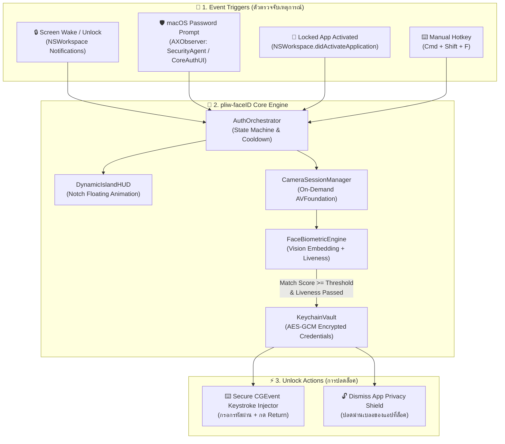

# 🪪 `pliw-faceID` — System Design & Architecture Specification

> **Status:** Draft / Ready for Implementation
> **Date:** 2026-11-11
> **Target Project Path:** `./pliw-faceID` (Standalone macOS Menu Bar App)
> **Release Portal Path:** `../pliw-app/pliw-faceID/`

---

## 1. Intent & Why (`ทำไมต้องมี pliw-faceID`)

ผู้ใช้ MacBook ต้องคอยเอื้อมนิ้วไปแตะปุ่ม Touch ID หรือพิมพ์รหัสผ่านซ้ำๆ ในหลายจังหวะของวัน เช่น:
1. ตอนเปิดฝาเครื่อง / ปลุกหน้าจอจากโหมด Sleep หรือหน้า Lock Screen
2. ตอน macOS เด้งหน้าต่างถามรหัสผ่านระบบ (`SecurityAgent` — เช่น ตอนติดตั้งแอป, แก้ไข System Settings, หรือปลดล็อค Keychain)
3. ตอนต้องการล็อคแอปส่วนตัว (App Locker) ไม่ให้คนอื่นที่มายืมเครื่องเปิดดูได้ง่ายๆ

**`pliw-faceID`** จึงถูกออกแบบให้เป็นแอปพลิเคชัน macOS Menu Bar น้ำหนักเบาที่จำลองประสบการณ์ **Face ID + Dynamic Island HUD** บน MacBook โดยใช้กล้อง FaceTime HD ร่วมกับ Apple `Vision` Framework (และตัวเลือกเสริมผ่าน iPhone Continuity) เพื่อยืนยันใบหน้าและปลดล็อค/กรอกรหัสผ่านให้อัตโนมัติภายในเสี้ยววินาที

---

## 2. Goals, Non-Goals & Anti-Goals

### ✅ Goals (เป้าหมายหลัก)
- **Fast On-Device Face Recognition (< 400ms):** สแกนและเปรียบเทียบใบหน้าผ่านกล้อง MacBook ด้วย `Vision` (`VNGenerateFaceCaptureQualityRequest` + Feature Print / Landmark Embedding) บนเครื่อง 100% ไม่ส่งรูปขึ้น Cloud
- **3 จุดประสงค์การปลดล็อคครบวงจร:**
  1. **System Auth Dialog Auto-Fill:** ตรวจจับเมื่อหน้าต่างถามรหัสผ่านของ macOS (`SecurityAgent` / `CoreAuthUI`) เด้งขึ้นมา -> สแกนหน้า -> พิมพ์รหัสผ่าน + กด `Return` ให้อัตโนมัติ
  2. **Wake / Screen Unlock Assist:** เมื่อหน้าจอตื่นจาก Sleep (`NSWorkspace.screensDidWakeNotification`) สแกนหน้าทันทีเพื่อส่งรหัสผ่านปลดล็อค
  3. **Per-App Privacy Shield (App Locker):** เลือกแอปที่ต้องการล็อค (เช่น LINE, Messages, Notes, Settings) เมื่อเปิดหรือสลับไปแอปนั้น จะแสดงหน้าต่างเบลอทับ (`NSWindow` เหนือแอป) จนกว่าจะสแกนหน้าผ่าน
- **Anti-Spoofing (Basic Liveness Check):** ป้องกันการเอารูปถ่ายมาจ่อกล้องด้วยระบบตรวจจับการกะพริบตาหรือขยับศีรษะเล็กน้อย (`EAR - Eye Aspect Ratio` / Yaw Change) แบบเลือกเปิด-ปิดความเข้มงวดได้
- **Dynamic Island HUD:** แสดงแอนิเมชันสแกนใบหน้าแบบ Floating Pill บริเวณขอบบนหน้าจอ (ใกล้รอยบาก/กล้อง MacBook) ให้ความรู้สึกเหมือน Face ID บน iPhone/iPad Pro
- **Military-Grade Local Storage:** เก็บรหัสผ่านและ Face Embedding Vector ไว้ใน **macOS Keychain** เท่านั้น

### 🚫 Non-Goals (สิ่งที่ไม่ได้ทำในเฟสแรก)
- ไม่ได้ดัดแปลง Kernel ของ macOS หรือปิดการใช้งาน SIP (System Integrity Protection) เพื่อให้ติดตั้งง่ายและปลอดภัยต่อเครื่อง
- ไม่สามารถปลดล็อคหน้า FileVault ตอนเพิ่งเปิดเครื่องใหม่ (Cold Boot) ก่อนที่ macOS User Session จะโหลดเสร็จ (เนื่องจากเป็นข้อจำกัดระดับ Hardware Secure Enclave ของ Apple)

### ❌ Anti-Goals (สิ่งที่จะถือว่าล้มเหลวแม้โค้ดทำงานได้)
- **ห้ามเปิดกล้องค้างไว้ตลอดเวลา (No Always-On Camera):** กล้องไฟสีเขียวจะต้องติดเฉพาะจังหวะที่มี Event ต้องปลดล็อคเท่านั้น (ใช้เวลาเปิดกล้องไม่เกิน 0.5–1.5 วินาทีแล้วปิดทันที) เพื่อไม่ให้กินแบตเตอรี่และไม่ให้ผู้ใช้รู้สึกถูกแอบมอง
- **ห้ามเก็บรูปถ่ายใบหน้าดิบลงดิสก์:** เก็บเฉพาะค่าตัวเลขคณิตศาสตร์ (Facial Feature Vector) เท่านั้น

---

## 3. Architectural Approaches Considered

| แนวทาง (Approach) | รายละเอียดการทำงาน | ข้อดี / ข้อเสีย | การตัดสินใจ |
| :--- | :--- | :--- | :--- |
| **A. Hybrid Local Vision + Accessibility Auto-Fill (Recommended)** | แอป Menu Bar ในยูสเซอร์สเปซ ใช้ `AVFoundation` + `Vision` สแกนหน้าเมื่อเกิด Trigger (Dialog เด้ง / Wake / เปิดแอปล็อค) แล้วใช้ `CGEvent` + Accessibility API กรอกรหัสจาก Keychain | ✅ ไม่ต้องปิด SIP<br/>✅ แพ็กเป็น `.dmg` แจกจ่ายผ่าน `pliw-app` ได้ทันที<br/>✅ ทำงานได้ทั้ง Lock Screen (Wake), System Prompt และ App Locker | **⭐ เลือกใช้วิธีนี้เป็นแกนหลัก** |
| **B. PAM Module (`pam_tid` / Custom Authorization Plugin)** | เขียนโมดูลภาษา C/Swift ฝังใน `/etc/pam.d/sudo` และ `/Library/Security/SecurityAgentPlugins` | ✅ ทำงานระดับ OS Auth<br/>❌ ต้องใช้สิทธิ์ Root ลึก เสี่ยงเครื่องค้างถ้าอัปเดต macOS และทำ `.dmg` แจกจ่ายยาก | เก็บไว้เป็น Optional CLI Helper สำหรับคำสั่ง `sudo` ใน Terminal เท่านั้น |
| **C. iPhone Companion Relay (Continuity Biometrics)** | ส่งสัญญาณผ่าน `MultipeerConnectivity` / BLE ไปให้แอปคู่หูบน iPhone สแกน Face ID จริง (TrueDepth IR) แล้วส่ง Token กลับมาปลดล็อค Mac | ✅ ได้ความปลอดภัยระดับ Hardware IR แท้<br/>❌ ต้องหยิบหรือหันหน้าเข้าหา iPhone และต้องดูแล 2 โค้ดเบส (macOS + iOS) | วางโครงสร้าง `BiometricProviderProtocol` รองรับไว้ต่อยอดใน v2.0 |

---

## 4. System Architecture & Data Flow



---

## 5. Core Components Specification

### 5.1 📷 `CameraSessionManager` & `FaceBiometricEngine`
- **On-Demand Lifecycle:** เปิด `AVCaptureSession` ความละเอียด `640x480` @ 30fps เฉพาะเมื่อ `AuthOrchestrator` สั่งเริ่มสแกน และสั่ง `stopRunning()` ทันทีที่สแกนผ่านหรือครบ Timeout (3 วินาที)
- **Multi-Angle Enrollment (การลงทะเบียนใบหน้า):**
  - ให้ผู้ใช้สแกนใบหน้า 3–5 มุม (หน้าตรง, หันซ้ายเล็กน้อย, หันขวาเล็กน้อย, ตอนใส่แว่น/ไม่ใส่แว่น)
  - สกัด Feature Vector ด้วย `VNGenerateImageFeaturePrintRequest` (ครอปเฉพาะกรอบใบหน้าจาก `VNDetectFaceLandmarksRequest` ที่จัด Alignment แล้ว) ร่วมกับสัดส่วนเรขาคณิตของใบหน้า (68-point Landmarks Ratio)
- **Matching & Liveness:**
  - คำนวณ Cosine Distance ระหว่างใบหน้าปัจจุบันกับโปรไฟล์ที่ลงทะเบียนไว้ (Threshold ปรับได้: *Fast / Balanced / Strict*)
  - **Liveness Check:** ตรวจวัดการเปลี่ยนแปลงของมุมหน้า (Micro-movement) หรือการกะพริบตาจากเฟรมต่อเนื่อง 3–5 เฟรม เพื่อป้องกันการนำรูปถ่ายนิ่งบนมือถือมาส่องกล้อง

### 5.2 🛡️ `SecurityPromptWatcher` (System Password Dialog Detector)
- ใช้ `AXUIElement` และ `NSWorkspace.shared.runningApplications` ร่วมกับ Timer/Observer น้ำหนักเบา เพื่อตรวจจับเมื่อกระบวนการต่อไปนี้แสดงหน้าต่างที่มีช่อง `AXSecureTextField` (ช่องกรอกรหัสผ่าน):
  - `com.apple.SecurityAgent` (หน้าต่างถามรหัสผ่านตอนตั้งค่าระบบ / ติดตั้งแอป)
  - `com.apple.CoreAuthUI` (หน้าต่างยืนยัน Touch ID / รหัสผ่านของระบบ)
  - `loginwindow` (หน้าจอปลดล็อคเครื่อง)
- เมื่อตรวจพบช่องกรอกรหัสผ่าน -> เรียก `AuthOrchestrator` สแกนหน้า -> หากตรงกัน จะดึงรหัสผ่านจาก `KeychainVault` แล้วส่งเข้าช่องกรอกรหัสผ่านพร้อมกดปุ่ม `Return` ให้อัตโนมัติ

### 5.3 🔐 `AppLockerManager` (ระบบล็อคแอปด้วยใบหน้า)
- ผู้ใช้สามารถเลือกแอปใดก็ได้ในเครื่อง (เช่น **LINE, Messages, Photos, Notes, Chrome**) เข้าสู่รายการ Protected Apps
- ทันทีที่ `NSWorkspace.didActivateApplicationNotification` แจ้งว่าแอปนั้นถูกสลับขึ้นมาด้านหน้า:
  1. สร้างหน้าต่าง `PrivacyShieldWindow` (`NSVisualEffectView` เบลอมืดสนิท ระดับ `.screenSaver`) บังทับหน้าต่างแอปนั้นทันทีใน 16ms
  2. เริ่มสแกนใบหน้าผ่าน `DynamicIslandHUD`
  3. เมื่อใบหน้าตรงกับเจ้าของเครื่อง จึงค่อยซ่อนม่านเบลอออก และจำสถานะปลดล็อคไว้ตามเวลาที่ตั้งค่า (เช่น ล็อคใหม่ทันทีที่สลับแอป หรือล็อคเมื่อไม่ได้ใช้เกิน 5 นาที)

### 5.4 ✨ `DynamicIslandHUD` (UI & User Experience)
- หน้าต่าง `NSPanel` ไร้ขอบ (`borderless`, `nonactivatingPanel`) เกาะอยู่กึ่งกลางขอบบนสุดของหน้าจอ (ใต้กล้อง/Notch ของ MacBook)
- แสดง 4 สถานะพร้อม Spring Animation ลื่นไหล:
  1. **Scanning:** ไอคอน Face ID หมุนพร้อมกรอบสแกน (หรือเลือกเปิดพรีวิวกล้องวงกลมเล็กๆ ได้)
  2. **Matched (Success):** เปลี่ยนเป็นสีเขียวพร้อมเครื่องหมายถูก ✓ และหดกลับเข้าไปในขอบบน
  3. **Failed / Unknown Face:** สั่นเบาๆ (Shake Animation) สีแดง พร้อมปุ่มกด "Scan Again" หรือสลับไปพิมพ์รหัสปกติ
  4. **Enrollment Wizard:** หน้าต่างตั้งค่าครั้งแรกแบบ Step-by-Step สวยงามเข้าใจง่าย รองรับ 3 ภาษา (`th`, `en`, `zh`)

---

## 6. Project Structure (`./pliw-faceID`)

โปรเจกต์แยกอิสระ 100% (Standalone Repository & Identity) ไม่มีการอ้างอิงโค้ด ใบรับรอง หรือการตั้งค่าใดๆ ร่วมกับโปรเจกต์อื่นในเครื่อง โดยใช้ Bundle ID เฉพาะตัว `com.pliw.faceid` และใบรับรองโค้ดไซน์เฉพาะของตัวเอง (`PliwFaceIDDeveloper`):

```text
pliw-faceID/
├── Package.swift
├── scripts/
│   ├── build_app.sh              # Build .app, Sign ใบรับรองถาวร + Camera/Accessibility Entitlements
│   └── create_dmg.sh             # สร้าง .dmg + .zip และซิงก์เข้า ../pliw-app/pliw-faceID/
├── Sources/
│   └── PliwFaceID/
│       ├── PliwFaceIDApp.swift  # MenuBarExtra + AppDelegate
│       ├── Core/
│       │   ├── AuthOrchestrator.swift
│       │   ├── CameraSessionManager.swift
│       │   ├── FaceBiometricEngine.swift
│       │   ├── KeychainVault.swift
│       │   ├── SecurityPromptWatcher.swift
│       │   ├── AppLockerManager.swift
│       │   └── KeystrokeInjector.swift
│       ├── Models/
│       │   ├── FaceProfile.swift
│       │   ├── AppConfig.swift
│       │   └── UnlockLogEntry.swift
│       └── UI/
│           ├── DynamicIslandHUD.swift
│           ├── PrivacyShieldWindow.swift
│           ├── EnrollmentWizardView.swift
│           ├── MenuBarPopoverView.swift
│           └── SettingsView.swift
└── Tests/
    └── PliwFaceIDTests/
        ├── FaceBiometricEngineTests.swift
        ├── AuthOrchestratorTests.swift
        └── AppConfigTests.swift
```
